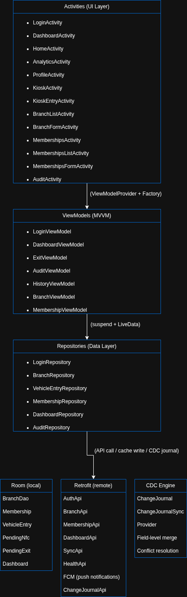

# AuraOS

**Sistema de Gestión de Estacionamientos Local-First** diseñado para sustituir registros analógicos en operaciones comerciales de gran escala. Opera de forma resiliente en entornos con conectividad intermitente sin pérdida de datos ni discrepancias contables.

---

## Índice

- [Propósito del Sistema](#propósito-del-sistema)
- [Stack Tecnológico](#stack-tecnológico)
- [Arquitectura del Sistema](#arquitectura-del-sistema)
- [Módulos Funcionales](#módulos-funcionales)
- [Modelo de Capacidad y Monetización](#modelo-de-capacidad-y-monetización)
- [Estrategia de Datos](#estrategia-de-datos)
- [Sistema de Sincronización](#sistema-de-sincronización)
- [Modos Atmosféricos](#modos-atmosféricos)
- [Estructura del Proyecto](#estructura-del-proyecto)
- [Desarrollo](#desarrollo)

---

## Propósito del Sistema

Los estacionamientos comerciales de alto volumen continúan dependiendo de libretas físicas para registrar ingresos y egresos, lo que genera las siguientes disfunciones operativas:

- **Fugas de capital** por ingresos no reportados
- **Errores de cálculo** en tarifas variables y membresías
- **Nula trazabilidad legal** ante reclamaciones por daños a la carrocería
- **Dependencia cognitiva del operador** para gestionar vencimientos de membresías

AuraOS resuelve estas deficiencias mediante un **sistema blindado con arquitectura Local-First**, integración de cámara para captura fotográfica de carrocería, lectura NFC, autenticación biométrica y un motor de auditoría contable inviolable.

---

## Stack Tecnológico

### Lenguaje y Plataforma

| Dimensión | Especificación |
|---|---|
| **Lenguaje** | 100% Kotlin — *null-safety*, *corrutinas*, *sealed classes* para máquinas de estado. |
| **minSdk** | 24 (Android 7.0 Nougat) — compatible con dispositivos ruggedizados de bajo costo |
| **targetSdk / compileSdk** | 36 (Android 16) — acceso a las APIs más recientes de la plataforma |
| **Build System** | Gradle con Kotlin DSL y Version Catalog (`libs.versions.toml`) |
| **Android Gradle Plugin** | 9.2.1 |

### Capa de Presentación

| Decisión | Fundamento Técnico |
|---|---|
| **XML Views + ViewBinding** | Renderización directa sin overhead de composición. *Type-safety* en acceso a vistas sin reflexión. |
| **Material Components** | Tema dual *DayNight* nativo. Componentes auditados (*BottomAppBar*, *CollapsingToolbar*, *ChipGroup*). |
| **Glassmorphism (Crystal/Midnight)** | Diferenciación de marca *High-Ticket* mediante fondos translúcidos, desenfoques (*blur*) y bordes grabados. Conmutación temática vía `?attr/...` sin modificar layouts. |

### Patrón Arquitectónico

| Decisión | Fundamento Técnico |
|---|---|
| **MVVM con LiveData** | *Lifecycle-aware*, sin gestión manual de suscripciones. Los `ViewModel` retienen estado ante cambios de configuración. |
| **ViewModelProvider + Factory** | Inyección explícita de dependencias sin framework de *dependency injection* (DI). Trazabilidad completa del grafo de dependencias. |
| **Intents explícitos + TabNavigator** | Navegación basada en *Activities* autocontenidas sin *Jetpack Navigation Component*. Control total del *backstack* con animaciones *slide* personalizadas. |

### Persistencia y Comunicación

| Componente | Propósito |
|---|---|
| **Room** | ORM con veración de consultas SQL en *compile-time*, soporte nativo de corrutinas (`suspend`) y migraciones progresivas. |
| **Retrofit + OkHttp + Gson** | *Stack* REST estándar de la plataforma. *Connection pooling*, *interceptors* de *logging* y timeouts configurables. |
| **ChangeJournal (CDC propio)** | Sistema de *Change Data Capture* (CDC) *append-only* que registra cada mutación (*CREATE, UPDATE, DELETE*) a nivel de campo para resolución de conflictos *field-level merge* durante la sincronización. |

### Hardware Integrado

| Periférico | Integración |
|---|---|
| **Cámara (5 capturas)** | Captura fotográfica de placa + 4 ángulos de carrocería (frente, trasera, izquierda, derecha) para trazabilidad legal ante reclamaciones por daños. |
| **OCR (servidor)** | La foto de placa se envía al backend (`POST /ocr/plate`) que ejecuta el reconocimiento óptico y devuelve el número de placa autocompletado. |
| **NFC** | Lectura de tarjetas NFC para identificación de miembros premium. Operación *offline* con encolamiento automático (*NfcSyncManager*). |
| **Biométrico (huella + Android Keystore)** | Autenticación sin contraseñas mediante par de llaves RSA respaldado por *hardware-backed keystore*. *Challenge-response* con el servidor. |

---

## Arquitectura del Sistema



### Flujo de Datos Transaccional

1. El operador ejecuta una mutación desde la capa de UI (ej. registro de ingreso vehicular).
2. El `ViewModel` delega la operación al `Repository` correspondiente.
3. El `Repository` ejecuta tres operaciones de forma concurrente:
   - **Escritura local**: inserción/actualización en Room (`...Dao.insert()`)
   - **Registro de CDC**: `ChangeJournal.recordCreate()` con el payload completo y metadatos de la mutación
   - **Llamada remota**: `POST /api/v1/...` mediante Retrofit
4. Si la llamada remota falla por ausencia de conectividad (`IOException`), el dato persiste exclusivamente en almacenamiento local más el journal de CDC.
5. El `SyncCoordinator` detecta la mutación pendiente y, tras un período de gracia de 800ms sin nuevas mutaciones (*debounce*), dispara el pipeline de sincronización.

---

## Módulos Funcionales

### 1. Autenticación (`LoginActivity`)

- **Dos modalidades de ingreso:**
  - *Quick Login*: email almacenado en `EncryptedSharedPreferences` con autenticación biométrica
  - *Full Login*: formulario completo para nuevos usuarios
- **Flujo biométrico**: al detectar un par de llaves RSA válido en el *Android Keystore*, se presenta automáticamente el `BiometricPrompt`. El *challenge* firmado se verifica contra `POST /api/v1/biometric-login`.
- **Fallback offline**: `LocalAuthDataSource` verifica contra el *hash* almacenado localmente en ausencia de red.

### 2. Dashboard (`DashboardActivity`)

Pantalla principal post-autenticación con los siguientes cuadros de información:

- **Barra de ocupación en tiempo real**: porcentaje de uso, tendencia vs. día anterior, ingresos acumulados del día
- **Membresías activas**: contador de membresías vigentes sobre el total registrado
- **Alertas críticas**: membresías próximas a vencer, capacidad crítica, llegadas VIP recientes
- **Navegación rápida**: accesos directos a Sucursales, Membresías, Salida, Kiosko y Auditoría
- **Bottom Navigation** con cuatro secciones: *Dashboard, Registrar, Analytics, Perfil*

### 3. Registro de Ingreso (`HomeActivity`)

Flujo principal de captura vehicular con cinco etapas:

| Etapa | Descripción |
|---|---|
| 1. Selección de sucursal | Diálogo de selección de sucursal activa |
| 2. Tipo de vehículo | Moto / Liviano / Pesado (camión) |
| 3. Captura fotográfica | 5 fotografías: placa, frente, trasera, lateral izquierdo, lateral derecho |
| 4. Reconocimiento de placa (servidor) | La foto de placa se envía al backend (`POST /ocr/plate`) que ejecuta el OCR y autocompleta el campo de número |
| 5. Membresía (opcional) | Asociación a membresía activa para aplicación de tarifa preferencial |
| 6. Confirmación | Registro local en Room + CDC + envío asíncrono a `POST /api/v1/vehicle-entries` |

### 4. Modo Kiosko (`KioskActivity` + `KioskEntryActivity`)

Modalidad de entrada rápida sin captura fotográfica completa, con dos vías de acceso:

- **Ticket (entrada diaria)**: formulario ligero con captura de placa (fotografía + OCR) y confirmación inmediata.
- **NFC (miembros)**: escaneo de tarjeta NFC para identificación automática del miembro. La entrada se registra con placa `"NFC"` y tipo de vehículo por defecto `"light"`.
  - Sin conectividad: la transacción se encola en `PendingNfcEntryEntity` y `NfcSyncManager` la propaga al restaurarse la conexión.

### 5. Registro de Salida (`ExitActivity`)

- Visualización de ingresos activos por sucursal seleccionada
- Búsqueda y filtrado por placa vehicular
- Previsualización de fotografías en diálogo modal
- Al seleccionar un ingreso activo: cálculo de duración, tarifa aplicable y confirmación de salida
- `PATCH /api/v1/vehicle-entries/{id}/exit` → actualización en Room + CDC con campos `exitedAt`, `duration`, `fee`

### 6. Gestión de Sucursales (`BranchListActivity` + `BranchFormActivity`)

Operaciones CRUD completas para sucursales:

- Lista con indicadores clave de rendimiento (KPI): capacidad, flota activa, porcentaje de ocupación
- Formulario de creación/edición: nombre, dirección, capacidad por tipo vehicular (*steppers*), tarifas (diurna/nocturna), horarios (*weekday/weekend*), moneda
- Eliminación con confirmación (*long-press*)
- Marcación de sucursal predeterminada

### 7. Membresías Premium (`MembershipListActivity` + `MembershipFormActivity`)

Administración de membresías de suscripción mensual:

- Lista con *tier*, fecha de expiración y estado (activo/inactivo)
- Creación/edición: nombre, *tier*, fecha de fin, escaneo opcional de NFC
- Asignación y desvinculación de tarjetas NFC
- Vista de detalles con identificador único de tarjeta (*cardUuid*)

### 8. Analítica e Historial (`AnalyticsActivity`)

- Filtros temporales: Hoy / Todo / Rango de fechas personalizado
- Búsqueda por placa vehicular
- Ordenamiento por tarifa o duración de estancia
- Lista paginada con previsualización de fotografías
- Métricas agregadas: ingresos totales, duración promedio, hora pico

### 9. Motor de Auditoría (`AuditActivity`)

Sistema de cierre de caja contable:

- Resumen del período contable corriente: ingresos por entrada, renovaciones de membresías, discrepancias detectadas
- Historial de cierres anteriores con detalle por lote
- Ejecución de cierre contable con separación de ingresos diarios vs. membresías
- Generación de reporte compartible mediante *Intent* estándar de Android
- Detección automática de membresías próximas a expirar (ventana de 7 días)

### 10. Perfil de Operador (`ProfileActivity`)

- Gestión de avatar (captura con cámara o selección desde galería)
- Activación/desactivación de autenticación biométrica
- Conmutación de tema visual: *Crystal Edition* (modo claro) ↔ *Midnight Edition* (modo oscuro)
- Cierre de sesión con limpieza de datos locales

---

## Modelo de Capacidad y Monetización

### Capacidad Física

| Tipo de Vehículo | Puestos Asignados | Regla de Conversión |
|---|---|---|
| Livianos | 50 | 1 camión ≡ 3 livianos |
| Camiones | 15 | — |
| **Total dinámico** | ~70 puestos equivalentes | Re-cálculo en tiempo real según composición de flota |

### Esquema de Monetización

| Producto | Precio |
|---|---|
| Tarifa plana diaria | $2.00 |
| Membresía premium mensual | $50.00 |

---

## Estrategia de Datos

### Paradigma Local-First

La aplicación opera bajo una estrategia **Local-First** que garantiza operatividad del 100% sin dependencia de conectividad de red:

1. Todas las mutaciones se persisten inmediatamente en Room (base de datos local SQLite).
2. Cada mutación genera un registro inmutable en el *ChangeJournal* (CDC) con el estado anterior y posterior de cada campo afectado.
3. La sincronización con el servidor remoto ocurre de forma asíncrona y desacoplada.

### Entidades de Base de Datos (Room)

| Entidad | Propósito |
|---|---|
| `BranchEntity` | Configuración de sucursales (capacidad, tarifas, horarios) |
| `VehicleEntryEntity` | Registro de ingresos/egresos vehiculares con metadatos fotográficos |
| `MembershipEntity` | Membresías premium con datos de tarjeta NFC |
| `DashboardEntity` | *Snapshot* de indicadores del dashboard |
| `ChangeJournalEntity` | Registro *append-only* de mutaciones para CDC |
| `PendingNfcEntryEntity` | Cola de entradas NFC pendientes de sincronización |
| `PendingExitEntity` | Cola de salidas pendientes de sincronización |
| `ExpiringMembershipEntity` | Vista materializada de membresías próximas a expirar |
| `VipArrivalEntity` | Registro de llegadas de miembros VIP |

---

## Sistema de Sincronización

### Componentes del Pipeline

| Componente | Responsabilidad |
|---|---|
| `SyncCoordinator` | Orquestador con *debounce* de 800ms. Acumula mutaciones antes de disparar sincronización. |
| `SyncManager` | Ejecutor principal que coordina *journals* y sincronización completa de entidades. |
| `ChangeJournalSyncManager` | *Push* de cambios locales, *pull* de cambios remotos y resolución *field-level merge* de conflictos. |
| `NfcSyncManager` | Procesamiento diferido de entradas NFC registradas sin conectividad. |
| `ExitSyncManager` | Procesamiento diferido de salidas registradas sin conectividad. |
| `ConnectivityObserver` | Monitoreo de conectividad mediante `registerDefaultNetworkCallback`. |
| `SyncRealtimeCoordinator` | Integración con *Server-Sent Events* (SSE) para notificaciones de sincronización en tiempo real. |
| `AuraFirebaseMessagingService` | Receptor de notificaciones *push* FCM para eventos del servidor. |

### Flujo de Sincronización

1. Toda mutación local escribe en Room + ChangeJournal.
2. `SyncCoordinator` detecta la mutación y espera 800ms sin nuevas mutaciones.
3. Al cumplirse el período de inactividad, se invoca `SyncManager.sync()`.
4. `ChangeJournalSyncManager` ejecuta primero: envía cambios locales pendientes y recibe cambios remotos, aplicando *field-level merge*.
5. Posteriormente se ejecuta la sincronización completa de entidades (*full pull* de sucursales, membresías y entries).
6. Cada cola *offline* (NFC, salidas) mantiene reintentos independientes con política de *retry* configurable.

---

## Modos Atmosféricos

El sistema implementa dos modos visuales conmutables mediante atributos personalizados (`?attr/...`) definidos en `res/values/attrs.xml` y asignados en ambos temas (*Crystal* y *Midnight*):

| Atributo | Crystal Edition (Light) | Midnight Edition (Dark) |
|---|---|---|
| `appLogoCustom` | `@drawable/ic_logo_crystal_light` | `@drawable/ic_logo_midnight_dark` |
| `loginBackgroundCustom` | `@drawable/login_background_day` | `@drawable/login_background_night` |
| `glassCardBackgroundCustom` | `@drawable/bg_glass_card` | `@drawable/bg_glass_card_dark` |
| `textPrimaryCustom` | Color primario oscuro | Color primario claro |
| `textSecondaryCustom` | Color secundario atenuado | Color secundario atenuado (invertido) |
| `dividerColorCustom` | Divisores oscuros con baja opacidad | Divisores claros con baja opacidad |

### Crystal Edition

- Fondo translúcido blanco satinado con opacidad 15% (`#26FFFFFF`)
- Bordes con opacidad 10% (`#1A000000`)
- `android:windowLightStatusBar = true`
- *Shadow* de elevación suave para profundidad de capas

### Midnight Edition

- Fondo translúcido negro con opacidad 20% (`#33000000`)
- Bordes reflectantes blancos con opacidad 15% (`#26FFFFFF`)
- `android:windowLightStatusBar = false`
- Degradados atmosféricos oscuros para inmersión visual

---

## Estructura del Proyecto

```
app/src/main/java/com/beta/auraos/
├── BaseActivity.kt                    # Conectividad + ChangeJournal wiring
├── DashboardActivity.kt               # Dashboard principal post-login
├── HomeActivity.kt                    # Registro de ingreso (5 fotos + OCR)
├── AnalyticsActivity.kt               # Historial y analítica
├── ProfileActivity.kt                 # Perfil de operador y configuración
├── KioskActivity.kt                   # Modo kiosko (NFC + ticket)
├── KioskEntryActivity.kt              # Formulario ligero de entrada kiosko
├── AuraApplication.kt                 # Application class con inicializaciones
├── ui/
│   ├── login/                         # LoginActivity, LoginViewModel, LoginFormState
│   ├── exit/                          # ExitActivity + ExitViewModel
│   ├── audit/                         # AuditActivity + AuditViewModel + AuditEngine
│   ├── branches/                      # BranchListActivity, BranchFormActivity + ViewModel
│   ├── memberships/                   # MembershipListActivity, MembershipFormActivity + ViewModel
│   ├── dashboard/                     # DashboardViewModel
│   ├── history/                       # HistoryViewModel
│   └── widget/                        # ConnectivityBannerView
├── data/
│   ├── BranchRepository.kt            # CRUD sucursales + Room + CDC
│   ├── MembershipRepository.kt        # CRUD membresías + tarjetas NFC + CDC
│   ├── VehicleEntryRepository.kt      # CRUD ingresos + salidas + analítica + CDC
│   ├── DashboardRepository.kt         # Dashboard fetch + cómputo local
│   ├── LoginRepository.kt             # Autenticación + biometría + sesión
│   ├── LoginDataSource.kt             # Llamadas de autenticación remota
│   ├── Result.kt                      # Tipo sellado Success/Error
│   ├── model/                         # Modelos de dominio (Branch, Membership, etc.)
│   ├── remote/                        # APIs Retrofit (Auth, Branch, Parking, etc.)
│   ├── local/
│   │   ├── room/                      # Database, entidades, DAOs, migraciones
│   │   ├── ChangeJournal.kt           # Fachada CDC (recordCreate/Update/Delete)
│   │   ├── ChangeJournalProvider.kt   # Proveedor de CDC con resolución de merges
│   │   ├── ChangeJournalSyncManager.kt # Push/pull/merge de CDC
│   │   ├── SyncCoordinator.kt         # Orquestador con debounce
│   │   ├── SyncManager.kt             # Sincronización completa
│   │   ├── SyncRealtimeCoordinator.kt # SSE en tiempo real
│   │   ├── ConnectivityObserver.kt    # Monitoreo de conectividad
│   │   ├── NfcSyncManager.kt         # Cola offline de entradas NFC
│   │   ├── ExitSyncManager.kt        # Cola offline de salidas
│   │   ├── SessionManager.kt         # EncryptedSharedPreferences
│   │   ├── BiometricKeyManager.kt    # Android Keystore RSA
│   │   ├── LocalAuthDataSource.kt    # Autenticación local offline
│   │   └── DashboardCalculator.kt    # Cómputo local de analítica
│   └── audit/                        # AuditEngine, FeeCalculator, AuditRepository
├── util/                              # TabNavigator, DateUtils, PhotoUrlBuilder,
│                                      # PasswordHasher, BottomNavIndicator, etc.
└── data/remote/fcm/                   # AuraFirebaseMessagingService
```

### Recursos (`app/src/main/res/`)

```
res/
├── drawable/                          # 35+ VectorDrawables XML + shapes glassmorphism
├── layout/                            # Layouts base para teléfono
├── layout-w936dp/                     # Overrides para landscape/tablet (>936dp)
├── layout-w1240dp/                    # Overrides para tablet grande (>1240dp)
├── menu/                              # Menú de opciones (menu_home.xml)
├── mipmap-{density}/                  # WebP icons para todas las densidades
├── mipmap-anydpi-v26/                 # Definiciones de adaptive icon
├── values/                            # colors, strings, themes, attrs, dimens
├── values-night/                      # Temas Midnight Edition
├── values-land/                       # Overrides landscape
├── values-w600dp/                     # Overrides tablet pequeño
├── values-w1240dp/                    # Overrides tablet grande
└── xml/                               # backup_rules, data_extraction_rules, file_paths
```

---

## Desarrollo

### Requisitos del Entorno

- Android Studio Ladybug (2024.2) o superior
- JDK 17+
- Gradle 9.4.1+
- Android SDK 36 (compileSdk)

### Compilación

```bash
git clone <repo-url>
cd AuraOS
./gradlew assembleDebug
```

### Configuración de Backend

La URL base del servidor se define en `data/remote/ApiClient.kt`:

```kotlin
private const val BASE_URL = "http://192.168.0.143:3000/"
```

El backend actual es una aplicación Node.js que expone *endpoints* REST. Los contratos de API están definidos mediante interfaces Retrofit en el paquete `data/remote/`.

### Gestión de Dependencias

Todas las dependencias se administran centralizadamente mediante *Version Catalog* en `gradle/libs.versions.toml`. Para incorporar una nueva dependencia:

1. Registrar la versión en la sección `[versions]`
2. Agregar las coordenadas de la librería en `[libraries]`
3. Referenciar en `app/build.gradle.kts` mediante `implementation(libs.nombre)`

### Migraciones de Esquema Room

Las migraciones de base de datos son explícitas y manuales. Cada modificación del esquema requiere:

1. Definir una nueva constante `MIGRATION_X_Y` en `AppDatabase.kt`
2. Incrementar la propiedad `version` en la anotación `@Database`
3. Está prohibido el uso de `fallbackToDestructiveMigration()`

### Convenciones de Código

- **Nomenclatura**: *lowerCamelCase* para funciones y variables; *PascalCase* para clases; *snake_case* para recursos.
- **ViewBinding**: inflado exclusivamente mediante `ActivityLoginBinding.inflate(layoutInflater)` y asignación de `binding.root` como *content view*.
- **ViewModel**: instanciación mediante `ViewModelProvider(this, viewModelFactory())`.
- **LiveData**: suscripción con `.observe(this@Activity) { }` para garantizar *lifecycle-aware*.
- **Edge-to-Edge**: invocación de `enableEdgeToEdge()` en `onCreate` previo a `setContentView`.
- **Navegación**: *Intents* explícitos entre actividades sin *Jetpack Navigation Component*.

---

> **Desarrollador:** Luis Angel Gutierrez · [GitHub](https://github.com/LR-Gutierrez) · luisangelrgr@gmail.com
>


## License

MIT — see [LICENSE](LICENSE).
